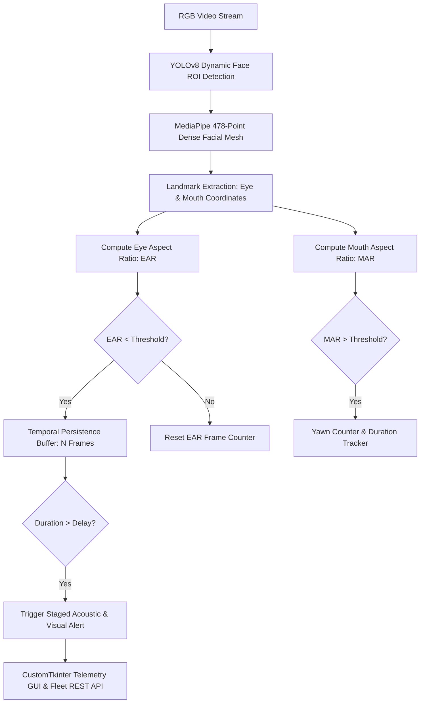

# Driver Eye Detection System

<div align="center">

[](https://python.org)
[](https://opencv.org)
[](https://developers.google.com/mediapipe)
[](https://github.com/Midhun-M-git/DRIVER_EYE_DETECTION/actions/workflows/python-ci.yml)
[](LICENSE)

</div>

A real-time driver drowsiness and fatigue monitoring pipeline powered by MediaPipe Face Mesh (478-Point Architecture) and YOLOv8 for face tracking. Optimized for low-latency detection in low-light and high-movement automotive environments.

---

## Detection Pipeline Architecture



---

## Algorithmic Foundation

The system monitors ocular fatigue using the **Eye Aspect Ratio (EAR)** formulation across vertical and horizontal eye landmark distances:

$$\text{EAR} = \frac{||p_2 - p_6|| + ||p_3 - p_5||}{2 \cdot ||p_1 - p_4||}$$

Where $p_1 \dots p_6$ correspond to 2D landmark locations on the facial mesh around the eye contour. When the eye closes, $\text{EAR}$ decreases toward zero, distinguishing genuine microsleep episodes from reflexive blinks via temporal persistence thresholds.

---

## Features

- **478-Point Landmark Mesh**: Dense facial landmark geometry for accurate Eye Aspect Ratio (EAR) and Mouth Aspect Ratio (MAR) computation.
- **Yawn Invariance**: Automated kinematic distinction between natural conversational speech and sustained yawning cycles.
- **Staged Audio-Visual Alerts**: Multi-tier alert hierarchy distinguishing between early fatigue and critical micro-sleep states.
- **Telemetry Interface**: CustomTkinter desktop interface featuring real-time eye aspect metrics and status telemetry.
- **REST Fleet Telemetry**: Integrated Flask server designed for remote vehicle fleet monitoring and event logging.

---

## Prerequisites

- Python 3.10 or higher
- OpenCV, MediaPipe, Ultralytics, PyTorch
- CustomTkinter

---

## Quick Start

### Windows
1. Run `SETUP_ENVIRONMENT.bat` to configure the Python virtual environment and install dependencies.
2. Run `RUN_APP.bat` to launch the telemetry dashboard.

### macOS / Linux
```bash
chmod +x run.sh
./run.sh
```

---

## Threshold Calibration

- **EAR Threshold**: Set the baseline eye aspect ratio to adjust closed-eye sensitivity.
- **MAR Threshold**: Calibrate yawn detection threshold based on facial aspect metrics.
- **Consecutive Frame Delay**: Adjust the persistence threshold (e.g., 2.0 seconds) to prevent false positives from natural blinking.

---

## License

This project is licensed under the MIT License. See the [LICENSE](LICENSE) file for details.
